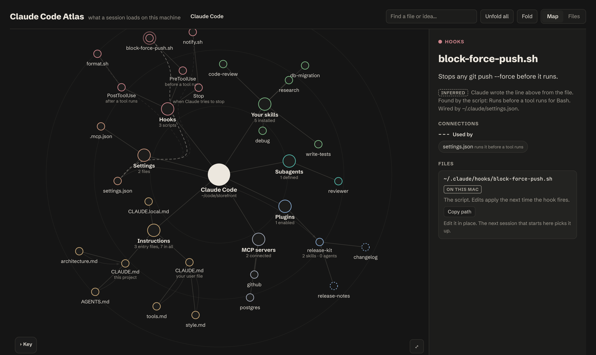

# agent-atlas

**See everything Claude Code loads before it reads your first message.**

Every session quietly loads a stack of things: your `CLAUDE.md`, the files it `@`-imports, project
rules from every parent folder, settings at three levels, hooks, skills, subagents, plugins and MCP
servers. agent-atlas finds all of them on your machine and draws them as one map you can fold,
search and click through.



*A made-up project, rendered by `npm run screenshot`. Your own map stays on your machine.*

## Install

In Claude Code (2.1.275 or later):

```text
/plugin install agent-atlas --marketplace Leit-motif/agent-atlas
```

## Use

Open Claude Code in any project and run:

```text
/agent-atlas:atlas
```

Or just ask: *"Map what Claude Code loads here."* Claude finds every file, writes a one-line
summary of each, and opens the map in your browser. The page and its data are saved under
`~/.claude/agent-atlas/`, never inside your project. Run it again after changing your setup; only
files that changed get new summaries.

Needs Node 20 or later. Nothing else to install.

### Without Claude

The scripts also run on their own, without summaries:

```bash
git clone https://github.com/Leit-motif/agent-atlas && cd agent-atlas
```

```bash
mkdir -p out && node src/discover.mjs --cwd /path/to/your/project --json > out/graph.json
```

```bash
node src/build.mjs out/graph.json out/atlas.html
```

## What it finds

| Area | Where it looks |
|---|---|
| Instructions | `~/.claude/CLAUDE.md`, `~/.claude/rules/`, every `CLAUDE.md`, `.claude/CLAUDE.md` and `CLAUDE.local.md` from your project up to `/`, project `.claude/rules/`, Claude's auto memory, managed policy files |
| Imports | Every `@path` in those files, followed recursively, skipping code blocks and inline code. Missing imports are flagged. |
| Settings | User, project and local `settings.json`, plus `.mcp.json` |
| Hooks | Each hook command traced to the script it runs, including plugin hooks and function-hook modules |
| Skills and subagents | `~/.claude/skills`, `.claude/skills`, `~/.claude/agents`, `.claude/agents`, with each one's own description |
| Plugins | Enabled plugins, resolved through the install registry, with their skills, agents and hooks |
| MCP servers | Names and transport from `~/.claude.json` and `.mcp.json` |

Symlinks are followed to the real file, so a shared rules file shows up once, wherever it lives.

## What it never shows

Discovery reads structure, not secrets. Environment variable values, MCP commands, arguments,
headers and tokens never reach the graph or the page; only names and counts do. The tests plant
fake secrets and fail if one leaks.

## Every line is proven, every summary is labelled

The lines on the map are things the script found: an import, a symlink, a hook wiring, a plugin
enabled in settings. Nothing is guessed.

Card text starts as each file's own heading or frontmatter. When you run the skill, Claude reads
each file and adds one plain sentence about what it does. Those lines show with an **Inferred**
label beside what the script found, so you can always tell Claude's words from the file's. Each summary is tied to
its file's contents, so when a file changes, its summary drops off and is requested again instead of
going stale.

## Status

Early. Claude Code only for now; `discover.mjs` also reads Codex's files, but the page doesn't
draw them yet. Tested on macOS.

```bash
npm test
```

MIT licensed.
